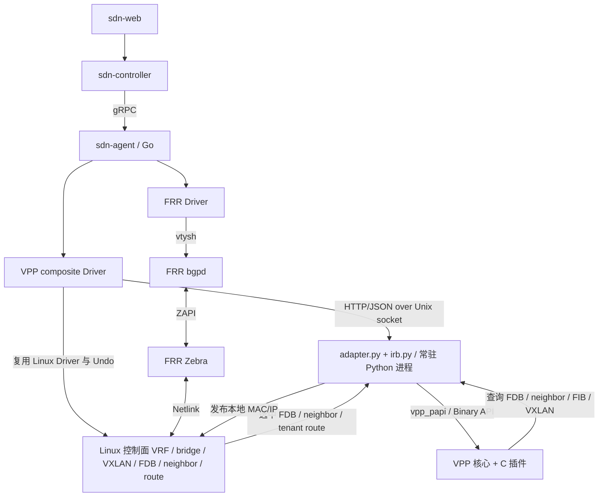

# VPP 与 SDN Agent 适配架构

更新日期：2026-10-27。

本文记录本 fork 的当前实现、组件边界、构建方式和后续方向。代码位置与详细说明见 [适配开发文档](docs/developer/extras/sdn_agent.rst)、[使用指南](docs/usecases/sdn_agent.rst) 和 [Python 适配器说明](extras/sdn-agent/README.md)。配套 `sdn-agent` 仓库的 `docs/developer/vpp.rst` 包含完整节点表、操作与实验步骤。

## 1. 当前实现结论

- 已实现 VPP + FRR 的租户 FIB、BD/BVI、L2VNI/L3VNI、对称 IRB、原生多点 VXLAN、双栈远端以及查询。
- **当前通信路径是 Go Agent → Python 适配进程 → VPP Binary API → VPP 核心及 C 插件。没有专门的 `sdn_agent_plugin.so` 直接连接 Agent。**
- Python 是常驻控制进程，负责资源映射、事务配合和状态核对；逐包查表、封装、解封装、GSO 软件分段在 VPP 原生代码中执行。
- FRR 通过 Linux 控制面对象感知接口、VRF、VNI、MAC/IP；Linux 镜像与 VPP 转发表由适配层协调。
- 已验证基线为本地适配源码 VPP 26.06 / FRR 10.7.0。GitHub 适配代码尚待提交、推送，完整远端源码镜像构建待验证。

## 2. 控制架构与通信边界



| 组件或通道 | 当前职责 |
|---|---|
| Go Agent / VPP composite | 接收 typed operations，管理依赖、Prepare/Undo、Apply、Verify、Rollback 与 Query；内部复用 Linux Driver，不同时注册另一个独立 Linux Driver |
| FRR Driver / bgpd / Zebra | Agent 配置协议；bgpd 进行 EVPN 选路，Zebra 观察 Linux 对象并安装有效状态 |
| `adapter.py` | 接受本地配置 RPC，管理 BD、接口、原生 VXLAN、FDB、远端成员与周期核对 |
| `irb.py` | 管理租户 FIB、BVI、地址、Router MAC、邻居、选中 Type-2/Type-5 路由与 ARP/ND 抑制 |
| Agent → Python | HTTP/JSON 经 Unix socket，默认 `/run/sdn-agent/vpp.sock`，权限 `0600`；不监听外部 TCP 端口 |
| Python → VPP | `vpp_papi.VPPApiClient` 调用 Binary API，默认 `/run/vpp/api.sock` |
| VPP 原生代码 | 执行 BD/FIB/FDB 查表、VXLAN 远端选择、收发报文与封装解封装 |

当前没有 FPM server，也没有修改 Zebra 为直接调用 VPP API。适配器消费的是 Zebra 安装到受管内核对象的有效状态，不直接把全部 BGP RIB 候选路由装入 VPP。

配置请求与周期核对串行执行；周期核对约每秒一次。Python 不在逐包转发路径，但核对效率会影响控制面收敛速度。

## 3. Linux 控制镜像与 LCP

### 3.1 两类通道

```text
Linux underlay 地址 / 邻居 / 路由
    -> Netlink -> linux_nl -> VPP 配对接口 / underlay FIB

Linux BGP / OSPF 等控制报文
    <-> Linux TAP/TUN <-> VPP host-side TAP/TUN
    <-> LCP punt / xc <-> VPP 实际接口
```

Netlink 传递对象状态，TAP/TUN 传递报文，Binary API 编程 VPP 原生对象。三者分别承担不同职责。

普通 LCP 不会自动把任意 VPP BD、VRF、VXLAN 完整映射为 Linux 对象。给 TAP 起一个 `vx50000` 名字，也不会使 Zebra 认为它是 VXLAN。Agent/适配层需要建立具有正确 VNI、VTEP、bridge/VRF 关系的真实 Linux 控制对象。

受管 Linux 镜像端口保留 carrier，通过 tc ingress/egress priority `49150` 隔离业务帧；underlay LCP 控制通道保留。移除隔离会破坏业务在 VPP 转发的边界。

### 3.2 身份与节点

一个 LCP pair 涉及 VPP 实际接口 `phy_sw_if_index`、VPP 主机侧接口 `host_sw_if_index`、目标 Linux namespace 内的 ifindex。phy 也可为软件接口。重建后接口索引可能变化，不能作为持久身份。

| 节点 | 类型 | 作用 |
|---|---|---|
| `dpdk-input` / `tap-input` | INPUT | 从实际设备或 TAP/vhost 队列收包，属于设备插件 |
| `linux-cp-xc-ip4` / `linux-cp-xc-ip6` | INTERNAL | Linux TAP 发包，经配对接口 adjacency 与输出 feature 发送 |
| `linux-cp-xc-l3-ip4` / `linux-cp-xc-l3-ip6` | INTERNAL | TUN 的三层发送，使用 P2P adjacency 或 P2MP FIB，处理本地产生标记 |
| `linux-cp-xc-mpls` | INTERNAL | 主机 MPLS 到配对接口；存在此节点不代表本项目已验收 MPLS |
| `linux-cp-punt` / `linux-cp-punt-xc` | INTERNAL | 根据配对关系选择交付接口，TAP 路径恢复二层头 |
| `linux-cp-punt-l3` | INTERNAL | TUN punt 的 locally-originated / TTL 处理，继续 punt redirect |
| `linux-cp-arp-phy` / `linux-cp-arp-host` | INTERNAL | 当前 phy 路径复制 ARP reply 给主机并继续原 feature；host 路径将 ARP 发往实际接口 |
| `linux-cp-netlink-process` | PROCESS | 等待、批处理和重同步 Netlink 控制事件 |

实际节点路径取决于 feature、TAP/TUN 和 punt 注册，需结合 trace 核对。普通业务包不必经过 Linux。当前租户 BVI 的网关 ping 与邻居处理在 VPP，租户内部 BGP/OSPF 到 Linux 的 punt 通道尚未实现。

## 4. EVPN 状态同步与原生多点 VXLAN

| 有效状态 | VPP 中的结果 |
|---|---|
| Type-2 MAC 与远端 VTEP | BD 的 FDB 和 VNI 内 MAC→VTEP 映射 |
| Type-2 MAC/IP、Router MAC | 租户主机路由、传输 BVI 下一跳邻居及远端 ARP/ND 抑制 |
| Type-3 / 零 MAC FDB | VNI 内独立 BUM 复制成员 |
| Type-5 选中前缀 | 租户 FIB 的前缀及下一跳，支持内联 ECMP 与 nexthop/group |
| VPP 本地接入 FDB / BVI 邻居 | 发布到 Linux 控制镜像，驱动 Zebra/bgpd 通告本地主机 |

本地邻居发布必须匹配接入侧 FDB，避免把远端 MAC/IP 再次通告为本地。Type-3 BUM 与 Type-2 单播引用独立撤销，远端全部撤销后 VNI 接口仍保留。

每个 VNI 使用一个原生多点 VXLAN 接口，创建时只指定本地 `src`，无固定 `dst`；封装时根据内层目的 MAC 找到远端 VTEP，BUM 按成员复制。线上报文始终有明确的外层目的 IP。远端与本地 VTEP 必须同地址族，两种外层都可承载内层 IPv4/IPv6。

VXLAN API 为 `2.3.0`，双栈入口为 `vxlan_mp_remote_add_del_v2` / `vxlan_mp_remote_v2_dump`，旧 IPv4 API 保留兼容。`l2_egress_flood` 扩展位于 L2 API `3.4.0`。

多点接口使用 SHG 1，禁止远端间反射与远端数据面学习；远端 MAC 使用可移动 FDB 项。更新在 worker barrier 下执行，旧目的的迟到删除不能撤销新目的映射。接收端先匹配固定 dst 隧道，再匹配多点接口；远端映射不是接收 ACL。

## 5. 二层与三层报文流程

同一二层网段：

```text
PC -> 接入端口 -> 业务 BD 查目的 MAC
   -> L2VNI VXLAN 端口 -> MAC→远端 VTEP
   -> VXLAN 封装 -> underlay FIB -> 实际出口
```

跨网段采用对称 IRB。业务 BD/BVI 和 L3VNI 的传输 BD/BVI 关联同一租户 FIB；传输 BVI 可无 IP，但具有 Router MAC。L3VNI 使用 Ethernet VXLAN，不使用原生 raw-IP `is_l3` 替代。

```text
Leaf1 发送：
PC1 -> 接入 BD10 -> 网关 BVI -> 租户 FIB 查路由
    -> 传输 BVI -> 传输 BD(br50000) -> 远端 Router MAC 查 FDB
    -> L3VNI50000 VXLAN 端口 -> 按 Router MAC 选择 VTEP
    -> 封装 -> underlay FIB -> VF

Spine：外层 IP 转发，不解封装 VXLAN。

Leaf2 接收：
VF -> VXLAN 解封装 -> 传输 BD(br50000)
   -> 本机 Router MAC / 传输 BVI -> 租户 FIB 查路由
   -> 业务 BVI -> 本地接入 BD20 -> PC2
```

参考租户 `TENANT-A/table1001`，PC1 为 `192.168.10.11/24`、网关 `.254`，PC2 为 `192.168.20.12/24`、网关 `.254`；业务 L2VNI 分别为 `10010/10020`，共同 L3VNI 为 `50000`，L3 RT 为 `65000:1`。Type-2 主机路由即可支持该跨网段通信，发布整个前缀时另启用 Type-5。

BD 名称、数值 BD ID、VNI、租户 table ID 与接口索引是不同标识；`br50000` 不代表 VPP BD ID 必为 50000。`encap_vrf_id` 选择外层 underlay FIB，不是内层租户 VRF。

## 6. startup.conf 配置入口与生命周期

**集成镜像已支持通过宿主机挂载配置 VPP 启动文件；当前没有 Web/Controller 编辑或下发 startup.conf 的接口。**

| 配置 | 当前含义 |
|---|---|
| `agent.dataplane=vpp` | 选择 VPP composite，要求 `agent.frr=true`，修改后重启 |
| `vpp.startupConfig` | VPP 启动配置，默认 `/etc/vpp/startup.conf` |
| `vpp.apiSocket` | 默认 `/run/vpp/api.sock`，必须与 startup.conf 的 `socksvr.socket-name` 一致 |
| `vpp.adapterSocket` | 默认 `/run/sdn-agent/vpp.sock`，Agent 与 Python 的控制 socket |
| `vpp.startupTimeoutSeconds` | 默认 60 秒，等待 VPP 与适配器启动就绪 |

配置模板位于配套 Agent 仓库的 `docker/vpp/agent.conf` 和 `docker/vpp/startup.conf`。例如在宿主机准备：

```bash
cd ~/program/github/sdn-agent
mkdir -p ~/sdn-vpp-node
cp docker/vpp/agent.conf ~/sdn-vpp-node/agent.conf
cp docker/vpp/startup.conf ~/sdn-vpp-node/startup.conf
```

在创建容器时，将下列参数加入完整的 `docker run` 命令：

```bash
--mount type=bind,src="$HOME/sdn-vpp-node/agent.conf",dst=/etc/sdn-agent/agent.conf,readonly
--mount type=bind,src="$HOME/sdn-vpp-node/startup.conf",dst=/etc/vpp/startup.conf,readonly
```

以上是挂载参数片段，完整的设备权限、持久卷和令牌配置见配套 Agent 的 `docs/user/vpp.rst`。启动器实际执行 `vpp -c <vpp.startupConfig>`。可配置 CPU、内存、buffer、插件、DPDK 设备等；修改启动配置需要重启，无热加载。默认模板使用软件接口，禁用 DPDK；添加 PCI 配置还需相应设备映射、hugepages 和独占设备准备，配置文件本身不会授予这些资源。

启动顺序为配置校验 → Redis → VPP API → Python 适配器 → FRR → Agent。停止顺序为 Agent → 适配器 → FRR → VPP → Redis。原生 Go 二进制本身不负责拉起这些子进程，集成容器的 supervisor 承担进程管理。

`startup.conf` 管理进程和插件启动参数；接入接口/LCP/underlay 需由启动配置或配套初始化恢复。受管租户、BD、VXLAN 与路由通过 Agent typed operations 管理，手工 CLI 与 Agent 管理同一对象可能冲突。

## 7. 源码、镜像与版本一致性

构建入口在配套 Agent 的 `docker/build-vpp.sh`、`docker/vpp/Dockerfile.base`、`docker/vpp/Dockerfile.frr` 和 `docker/Dockerfile.vpp`。

| 参数 | 作用 |
|---|---|
| `VPP_REPOSITORY` / `FRR_REPOSITORY` | 默认 `https://github.com/nanfengnan1/vpp.git` / `https://github.com/nanfengnan1/frr.git` |
| `VPP_REF` | Git 模式必填，必须包含本 fork 适配代码的 tag、分支或 commit |
| `FRR_REF` | 默认 `frr-10.7.0`，支持 tag、分支或 commit |
| `VPP_SOURCE` / `FRR_SOURCE` | 各自优先使用指定本地完整 clone，不自动 checkout；须含 `.git` 目录，暂不支持 linked worktree |
| `BUILD_BASES` | 首次设为 `1`，先编译两种基础镜像再集成；`0` 复用匹配的基础镜像 |
| `VPP_IMAGE` / `FRR_IMAGE` / `AGENT_IMAGE` | 默认 `alpine/vpp:sdn-base` / `alpine/frr:sdn-base` / `alpine/sdn-agent:vpp-dev`，标签与源码版本独立 |
| `SOURCE_CACHE_BUST` | 移动分支需要刷新时更改；可重复发布优先固定完整 commit |

VPP 基础镜像同时打包原生插件、API JSON、匹配的 `vpp_papi`、`adapter.py` 和 `irb.py`。集成镜像从同一基础镜像复制这些内容，避免 C API 与 Python 错配。旧基础镜像没有这组文件时需重建。

镜像内 `/usr/share/vpp/source.json` 与 `/usr/share/frr/source.json` 记录实际 commit、请求 ref、dirty 与未跟踪文件哈希；源码差异另存。脚本通过独立 Git 上下文避免 FRR `.dockerignore` 排除历史。版本参数可选不代表任意版本组合兼容；缺失必要适配 API 的源代码会在编译前被拒绝。

## 8. 事务、持久化与恢复

Agent 保存 Linux Undo 和 VPP Undo，Apply 后读回两侧，失败逆序补偿。适配器修改对象前原子持久化期望模型与 previous 并 fsync；未完成事务形成恢复屏障，暂停周期核对，等待原 Undo 恢复。

模型文件为 `stateDir/vpp.json`，版本 2 兼容旧 L2 状态和 Undo，包含租户、BD/BVI、绑定、VNI 与地址。动态 EVPN 远端继续以 FRR 有效状态为准，模型文件不是完整运行快照。

受管对象使用 `sdn-agent/` ownership 标识，拒绝抢占其他 owner；删除按路由、绑定、BVI 和空闲租户 FIB 的依赖顺序进行。不同数据面不能直接共享既有任务/配置状态。

容器/VPP 重建先恢复 underlay 和 LCP，再恢复受管配置并等待 EVPN 收敛。**全量冷启动 Running 重放尚未实现**；手工 `ip`/VPP CLI 的运行状态不会自动成为启动配置。

## 9. 代码定位与验证范围

| 路径 | 关注点 |
|---|---|
| [extras/sdn-agent/adapter.py](extras/sdn-agent/adapter.py) | Unix RPC、PAPI、BD/VXLAN/FDB、状态模型与周期核对 |
| [extras/sdn-agent/irb.py](extras/sdn-agent/irb.py) | 租户 FIB/BVI、选中路由、邻居与镜像隔离 |
| [src/plugins/vxlan/multipoint.c](src/plugins/vxlan/multipoint.c) | `vxlan-mp-encap`、MAC→VTEP、BUM、软件 GSO/校验和 |
| [src/plugins/vxlan/vxlan.api](src/plugins/vxlan/vxlan.api)、[vxlan_api.c](src/plugins/vxlan/vxlan_api.c) | 原生多点接口及双栈远端 API |
| [src/plugins/vxlan/decap.c](src/plugins/vxlan/decap.c) | 固定/多点匹配、外层 UDP 校验和、offload 标记处理 |
| [src/vnet/l2/l2.api](src/vnet/l2/l2.api) | `l2_egress_flood` 扩展 |
| [src/plugins/linux-cp/lcp_interface.c](src/plugins/linux-cp/lcp_interface.c)、[lcp_node.c](src/plugins/linux-cp/lcp_node.c)、[lcp_nl.c](src/plugins/linux-cp/lcp_nl.c) | LCP 配对、报文节点与 Netlink process |
| [src/plugins/tap/rx_node.c](src/plugins/tap/rx_node.c) | IPv6 扩展头与 NEEDS_CSUM 处理 |
| [src/plugins/dpdk/device/driver.c](src/plugins/dpdk/device/driver.c)、[device.c](src/plugins/dpdk/device/device.c) | HiNIC3 PMD 描述及 VLAN 子接口空指针保护 |

配套 Agent 的 `internal/adapters/vpp/vpp.go` 是 Go Unix RPC 客户端，`docker/supervisor.py` 管理 VPP/适配器生命周期。

维护时分别验证三层：VPP 原生 C/API 行为、Python 适配映射与恢复、Agent typed operations/查询/事务。修改 API 后同步原生代码、API JSON、PAPI、适配器及文档，不能只替换 Python。

```bash
# VPP 仓库；单元测试，不修改宿主机网络
python3 -m unittest discover -s extras/sdn-agent -p 'test_*.py'
```

真实软件实验入口在 Agent 的 `lab/vpp_evpn.py`、`lab/vpp_irb.py`、`lab/vpp_offload.py`；华为 VF 实验为 `lab/vpp_sriov.py`，硬件准备/恢复步骤见 Agent 开发手册。

2026-10-27 已有验收证据：同一 Huawei HiNIC3 NIC 的三个 VF 构成 Leaf1–Spine–Leaf2，两个 VLAN 承载 underlay，PC 使用 VPP TAP；IPv4/IPv6 VTEP 分别通过 30/31 项检查，浏览器查询 6 项通过。Spine 抓包确认跨网段 PC1↔PC2 的 3,330 个 IPv4 报文使用 L3VNI50000，内层为 Router MAC。详细报告保存在 Agent 的 `artifacts/vpp/sriov/validation.md`、`final4`、`final6`。

该硬件实验使用静态 underlay 和接口 VTEP，未复现参考手册的 OSPF+Loopback 组网。Type-5 由软件实验验证，不扩大为 VF 实验的结论。24 项 Agent Docker 单元测试及 Dockerfile 静态检查通过；Agent 手册完整构建、VPP 新增手册定向构建通过，不等同 GitHub 完整镜像编译。

## 10. 待实现、待验收与讨论方向

| 状态 | 内容 |
|---|---|
| 未实现 | 租户内部 BGP/OSPF 到 Linux 的 punt 通道 |
| 未实现 | 全量冷启动 Running 重放、在线切换数据面、EVPN 多归属与 HA |
| 未实现 | Web/Controller 编辑或下发 `startup.conf`、启动配置热加载 |
| 未实现 | 全事件驱动的 EVPN 状态同步；当前约每秒核对 |
| 待验收 | 适配源码提交/推送后的 GitHub 完整镜像构建，以及新增版本组合 |
| 待验收 | 硬件 VXLAN TSO、RX LRO、RSS 多队列、外部物理布线、大规模收敛与生产吞吐 |
| 讨论方向，未决定迁移 | 将 Python 的适配与状态同步移入 Go，使 Agent 直接调用 VPP Binary API；现有 C 数据面功能保留 |

当前 TCP GSO 与校验和使用软件处理；IPv6 外层 UDP 校验和必须有效。保持 RX LRO 关闭，旧固定 src/dst 的 RX flow offload 规则不能用于多点接口。不要将网卡收发测试通过等同所有硬件隧道卸载已支持。

文档更新时分别标注设计、实现和实际验收结果。物理设备绑定、部署、完整编译与代码发布是独立操作，文档修改不表示这些步骤已经执行。
